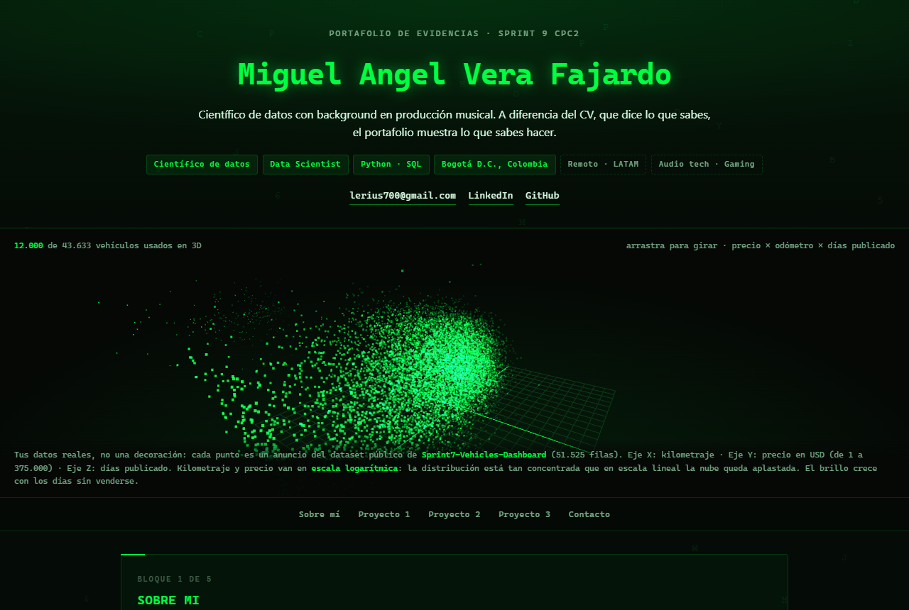

# Hola, soy Lerius

**Miguel Angel Vera Fajardo** — **Científico de datos en formación** (TripleTen Data Science) con background en producción musical.
Leo una forma de onda como quien lee un histograma: en la música para extraer patrones, en los datos para
convertirlos en decisiones.

  

## [Ver mi portafolio en vivo](https://lerius700-cmyk.github.io/)

Tres proyectos, cada uno con lo que hice, con qué herramientas trabajé y qué aprendí. Con datos reales,
cifras que se pueden verificar y enlaces que se abren: [**lerius700-cmyk.github.io**](https://lerius700-cmyk.github.io/)

## Proyectos

### 1. Dashboard de análisis de precios de vehículos &middot; Streamlit + Plotly

- **51.525 anuncios** de vehículos usados, con histograma del odómetro y dispersión de odómetro contra precio.
- **43.633** tienen odómetro registrado (de ahí sale el análisis) y el **precio medio es de 12.132 USD**.
- Deploy en un servidor público: se abre sin instalar nada.

[Demo en vivo](https://vehicles-dashboard-vtbj.onrender.com/) &middot; [Repositorio](https://github.com/lerius700-cmyk/Sprint7-Vehicles-Dashboard)

### 2. Void-Hunter &middot; Python + pygame

- Shooter vertical de pixel art: **9 escenas, 18 oleadas en actos de 6 y 4 jefes** con máquina de estados.
- Modo roguelike con semillas reproducibles y **efectos de sonido sintetizados por el propio proyecto**.
- Toda la música, compuesta y diseñada por mí. Release descargable para Windows.

**v1.7.2** &middot; **443 commits** &middot; **102 módulos de prueba** &middot; [Repositorio](https://github.com/lerius700-cmyk/Void-Hunter) &middot; [Release](https://github.com/lerius700-cmyk/Void-Hunter/releases/tag/v1.7.2)

### 3. Stellar-Horizon &middot; Python + pygame

- Shooter horizontal de pixel art de 16 bits: **480×270 escalados 4× a 1920×1080 a 120 FPS**, un acto con 6 oleadas y un
  jefe final con máquina de estados de 5 acciones, anillos de mejora al estilo Star Fox 64 y banda sonora MIDI.

**v1.7.2** &middot; **109 commits** &middot; **514 pruebas en verde** &middot; [Repositorio](https://github.com/lerius700-cmyk/Stellar-Horizon) &middot; [Release](https://github.com/lerius700-cmyk/Stellar-Horizon/releases/tag/v1.7.2)

## Stack

| Área | Herramientas |
|---|---|
| Datos | Python &middot; SQL &middot; pandas &middot; NumPy &middot; scipy &middot; Jupyter |
| Visualización | Plotly &middot; Streamlit &middot; Three.js &middot; JavaScript |
| Software | Pygame &middot; pytest &middot; PyInstaller &middot; Git &middot; GitHub Releases |
| Audio | Ableton Live &middot; mezcla y mastering &middot; MIDI |

## Contacto

- **Correo** &middot; <lerius700@gmail.com>
- **LinkedIn** &middot; [miguel-angel-vera-fajardo](https://www.linkedin.com/in/miguel-angel-vera-fajardo-0345ab389/)
- **GitHub** &middot; [lerius700-cmyk](https://github.com/lerius700-cmyk)
- **Música** &middot; [Lerius en Spotify](https://open.spotify.com/artist/0nqfYo03VormmBWC8TxxAn)

> Busco rol de científico de datos junior en LATAM, en remoto, dentro de audio tech, gaming o music streaming:
> son los tres sectores donde mi perfil es asimétrico.

<!--
Portafolio: https://lerius700-cmyk.github.io/
Fuente del sitio: https://github.com/lerius700-cmyk/lerius700-cmyk.github.io
-->
